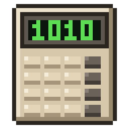
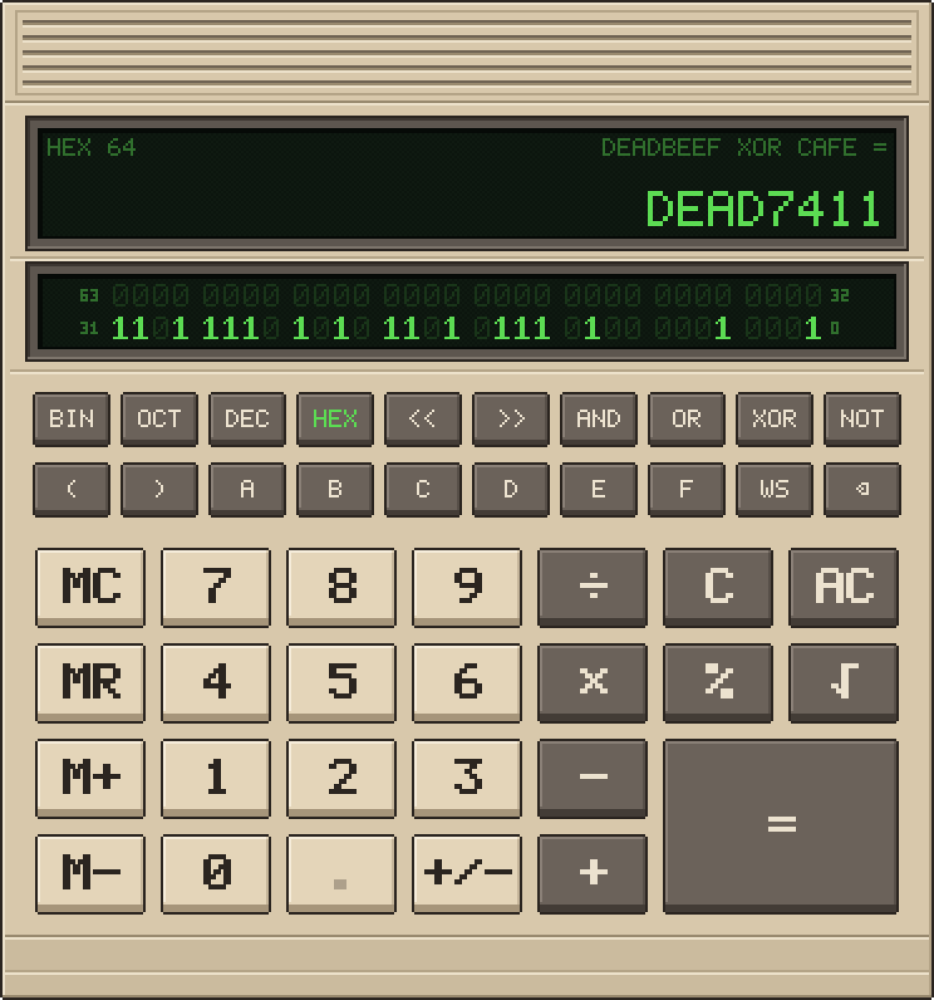

#  Digitron

A retro calculator for programmers. It looks like a pocket calculator from
the eighties, drawn pixel by pixel, and it does the arithmetic
correctly. It is written in Go with a Qt 6 interface using the
[miqt](https://github.com/mappu/miqt) bindings.



## Why Digitron

- **Exact, not nearly.** Digitron works in exact fractions, not floating
  point, so `0.1 + 0.2` is `0.3` and `1 ÷ 3 × 3` is `1`. Decimals that repeat
  are shown with a bar over the part that repeats, so `1 ÷ 7` is
  0.1̅4̅2̅8̅5̅7̅, not 0.14285714285714285.
- **Made for programmers.** Binary, octal, decimal and hexadecimal are one
  key away. In BIN, OCT and HEX, word sizes run from 8 to 64 bits in two's
  complement, and values wrap at the word size the way they do in your code.
  DEC has no limit at all: `2⁶³ + 1` and `1 << 100` come out exactly.
- **Every bit on show.** The second display shows the bits of the current
  value, and clicking a bit flips it. A fraction is shown as the IEEE 754
  floating-point number your code would hold, sign, exponent and mantissa
  set apart.
- **A calculator you want to look at.** Digitron is real low-resolution
  pixel art, scaled to sharp square pixels at any size, with keys that move
  and chirp when you press them.
- **Native and small.** It is a single compiled program, not a web page in a
  window. It starts at once and needs only Qt installed.
- **Nothing phones home.** No account, no telemetry and no network at all.

## Features

- **Bases:** BIN, OCT, DEC and HEX. Switching base keeps the value, except
  that BIN, OCT and HEX work in whole numbers, so a fraction is dropped. Keys
  that mean nothing in the current base are greyed out.
- **Word sizes:** 8, 16, 32 and 64 bits, chosen from a menu on the WS key.
  The status line shows the base and the word size. BIN, OCT and HEX keep to
  it, and switching to them from DEC drops a fraction and wraps the value into
  the word. DEC has no word size: it works with whole numbers and fractions of
  any size, exactly, and the word size says how the binary display shows
  them. Choosing a word size with a fraction showing makes it the nearest
  number that size's floating-point format holds, marked `≈` if that changed
  it: `0.1` at 16 bits becomes `0.0999755859375`. A fraction too big for the
  format, such as 70000.5 at 16 bits, is an error. A shift left of more than 65,536 places in DEC is refused.
- **The binary display** shows a whole number's bits in two's complement,
  grouped in fours. When a DEC result has a fractional part it switches to
  floating point, labelled `FP64`, `FP32`, `FP16` or `FP8` for the word
  size: IEEE 754 double, single or half precision, or for 8 bits FP8 E5M2.
  The bits are split into sign, exponent and mantissa, and are the nearest
  float to the exact value, rounding as IEEE 754 does, down to subnormals and
  up to infinity. Its bits cannot be clicked. A whole number too big for the
  word size has no bits worth showing, and the display says `BEYOND 64 BITS`
  (or the size chosen) until it fits again.
- **Bitwise operators:** AND, OR, XOR, NOT and shifts. `>>` is an arithmetic
  shift, so it keeps the sign.
- **Precedence like C:** `|` is lower than `^`, which is lower than `&`, then
  shifts, then `+` and `−`, then `×` and `÷`. `1 + 2 << 3` is 24.
- **Parentheses**, with the number still open shown on the display.
- **Square roots** worked out to 64 decimal places, so that what is made
  from them stays accurate, and marked with `≈` because they are not
  exact.
- **Percent** like a desk calculator: `200 + 10%` is 220, `50 × 10%` is 5.
- **Memory:** MC, MR, M+ and M−.
- **The expression** being worked out is shown above the result, and stays
  there after `=`.
- **Repeated `=`** does the last operation again, as on a desk calculator:
  `2 + 3 =` gives 5, and each `=` after it adds 3 again (8, 11, …). Type a
  new number and press `=` to do it to that instead: `2 + 3 = 7 =` is 10. It
  is the last operation outside any brackets, so `1 + 2 × 3 = =` multiplies
  by 3 again. AC forgets it.
- **The whole display is used:** a result is shown exactly when it fits the
  27 characters of the main display, and otherwise rounded to as many
  decimal places as fill it, wherever the point is, with `≈` shown. So
  `1 ÷ 97` is `0.0103092783505154639175258` and `123456789 ÷ 97` is
  `1272750.4020618556701030928`. A whole number is never rounded: a long one,
  as DEC can make, a long binary number, or a long number being typed, wraps
  onto smaller lines, which you scroll with the mouse wheel.
- **Copy and paste:** Ctrl+C copies the exact value, as a fraction such as
  `1/7` or `1/97` if its decimal repeats or is rounded on the display; a
  square root is copied as it is shown. Ctrl+V takes numbers with `0x`, `0o` or `0b`
  in front, with `_`, `,` or spaces between digits, and fractions such as
  `22/7` in decimal.
- **Sound:** every key press makes a short retro chirp, like an old
  mainframe terminal, and moving through the word-size menu makes a soft,
  dull tick. Each plays at a very slightly different pitch every time, so
  it never sounds mechanical. Both sounds are built into the program, and
  can be turned off in the [settings](#settings). The sound starts a moment
  after the window opens, so that the window can open at once; a key
  pressed in that first second makes no sound.
- **Resizing:** the calculator stretches to fill the window.
- **Remembers** the window size and the word size between runs. See
  [Settings](#settings).

## Keyboard shortcuts

Almost everything can be done from the keyboard.

| Keys | Does |
|---|---|
| 0–9, A–F | Type a digit (A–F in HEX only). |
| `.` or `,` | Decimal point (DEC only). |
| `+` `-` `*` or `x` `/` | Add, subtract, multiply, divide. |
| `=` or Return | Equals. |
| `&` `\|` `^` `~` | AND, OR, XOR, NOT. |
| `<` `>` | Shift left, shift right. |
| `(` `)` | Open and close parentheses. |
| `%` | Percent. |
| `r` | Square root. |
| `n` or F9 | Change sign (+/−). |
| Backspace | Delete the last digit typed. |
| Delete | Clear the entry (C). |
| Escape | Clear everything (AC). Memory, base and word size are kept. |
| F5, F6, F7, F8 | HEX, DEC, OCT, BIN. |
| `w` | Open the word-size menu. |
| Ctrl+C | Copy the exact value. |
| Ctrl+V | Paste a number. |
| Ctrl+Q | Quit. |

**In the word-size menu**

| Keys | Does |
|---|---|
| Up, Down, Home, End | Move the highlight. |
| Return, Enter or Space | Choose the highlighted size. |
| `8`, `1`, `3`, `6` | Choose 8, 16, 32 or 64 bits straight away. |
| Escape or `w` | Close the menu without changing anything. |

The mouse works too: click the keys, click a bit on the binary display to
flip it, and scroll the main display when a result is too long to show at
once.

## Requirements

Digitron is developed and tested on Linux.

Building needs:

- Go 1.27 or later
- A C++ compiler (GCC or Clang)
- `pkg-config`
- The Qt 6 base development files (Qt 6 Widgets)
- The Qt 6 Multimedia development files, for the sounds

### Linux

Install them with your distribution's package manager:

```sh
# Arch, CachyOS, Manjaro
sudo pacman -S go gcc pkgconf qt6-base qt6-multimedia qt6-multimedia-ffmpeg

# Debian, Ubuntu
sudo apt install golang-go build-essential pkg-config qt6-base-dev qt6-multimedia-dev

# Fedora
sudo dnf install golang gcc-c++ pkgconf-pkg-config qt6-qtbase-devel qt6-qtmultimedia-devel

# openSUSE
sudo zypper install go gcc-c++ pkgconf-pkg-config qt6-base-devel qt6-multimedia-devel
```

If your distribution's Go is older than 1.27, install Go from
[go.dev/dl](https://go.dev/dl/) instead.

Running a built binary on another machine only needs the Qt 6 runtime
libraries (`qt6-base` and `qt6-multimedia` on Arch, `libqt6widgets6` and
`libqt6multimedia6` on Debian and Ubuntu, `qt6-qtbase` and
`qt6-qtmultimedia` on Fedora, `libQt6Widgets6` and `libQt6Multimedia6` on
openSUSE).

### macOS

Digitron has not been tried on macOS, but it uses nothing specific to Linux.
Install the Xcode command line tools, which provide the Clang compiler, and
then the rest with [Homebrew](https://brew.sh):

```sh
xcode-select --install
brew install go pkgconf qt
```

The `qt` formula is Qt 6, Multimedia included. If `pkg-config` cannot find
it afterwards, tell it where Homebrew put Qt:

```sh
export PKG_CONFIG_PATH="$(brew --prefix qt)/lib/pkgconfig:$PKG_CONFIG_PATH"
```

### Checking

On either system, check that Qt can be found with:

```sh
pkg-config --modversion Qt6Widgets Qt6MultimediaWidgets
```

This should print two versions starting with 6.

## Building

```sh
make build
```

This is the same as:

```sh
go build -ldflags "-s -w" -o digitron .
```

The `-s -w` flags build without the symbol table and debug information, which
roughly halves the size of the binary, to about 33 MB.

The sounds, `sound/key.wav` and `sound/tick.wav`, are committed and
embedded in the binary. The chirp is cut from a recording; the ffmpeg
command that cut it is in `sound/sound.go`. The tick is made by a small
synthesiser in `sound/gen`. After changing the synthesiser, remake the tick
with:

```sh
go generate ./sound
```

A test fails if the committed tick no longer matches what the synthesiser
makes.

The first build compiles the whole Qt binding and takes several minutes,
printing a lot of compiler warnings from the Qt headers, which can be
ignored. Later builds use the Go build cache and take a few seconds.

## AppImage

Releases for Linux are an [AppImage](https://appimage.org): one file with
Digitron and the Qt libraries it needs inside it, which runs without
installing anything.

```sh
chmod +x Digitron-*-x86_64.AppImage
./Digitron-*-x86_64.AppImage
```

It is built by a GitHub workflow (`.github/workflows/appimage.yml`), which runs
`packaging/appimage.sh` on Ubuntu 22.04 with Qt's own build of Qt 6.9:

- Pushing a tag that starts with `v` builds it and attaches it to a release of
  that name: `git tag v1.0.0 && git push origin v1.0.0`.
- It can also be run by hand from the Actions tab of the repository (AppImage >
  Run workflow), which leaves the AppImage as an artifact of the run to
  download.

It runs under both X11 and Wayland, using Wayland where the session is one.
To use the other, set `QT_QPA_PLATFORM` to `xcb` or `wayland` when starting
it. Qt Multimedia, which plays the sounds, and its FFmpeg backend are in it;
the script will not make an AppImage without them, nor one that does not
start.

The C library of the system (glibc) is not put in the AppImage, as it cannot
be reliably: it has to match the system's graphics drivers. It is built on an
old distribution instead, and runs on any with glibc 2.35 or later (Ubuntu
22.04, Debian 12, Fedora 36 and anything newer, or rolling).

`make appimage` runs the same script locally, but an AppImage built on a newer
system only runs on systems at least as new. On a distribution whose Qt
Multimedia uses the system's FFmpeg, such as Arch, it is not made at all:
that FFmpeg brings a large tree of libraries with it, one of which does not
survive being packed, and the AppImage crashes as it starts, which the
script's check catches. Use the workflow, with Qt's own build, for releases.

## macOS app

Releases for macOS are a disk image, `Digitron-*-arm64.dmg`, for Macs with
Apple Silicon. Open it and drag Digitron into Applications. Macs with Intel
processors are not supported.

The app is not signed with an Apple Developer ID or notarised by Apple, so
the first time it is opened macOS says that it cannot check it for malicious
software and will not open it. Either:

- Open System Settings > Privacy & Security, where Digitron is named
  beneath Security, and choose Open Anyway, or
- take away the mark macOS gives what is downloaded, in Terminal:

  ```sh
  xattr -dr com.apple.quarantine /Applications/Digitron.app
  ```

Either is only needed once. It is signed ad hoc, which a Mac with Apple
Silicon needs to run it at all.

It is built by a GitHub workflow (`.github/workflows/macos.yml`), which runs
`packaging/macos.sh` on a Mac with Apple Silicon and Homebrew's Qt, when a
`v` tag is pushed, as the AppImage is, or by hand from the Actions tab (macOS
> Run workflow). The script builds the program, makes `Digitron.app` with
its icon (from `packaging/macos/digitron.png`) and `Info.plist` (from
`packaging/macos/Info.plist`), copies Qt into it with Qt's `macdeployqt`,
checks that Qt Multimedia's FFmpeg plugin is in it and that nothing in it
still uses a library from outside it, signs it, checks that it starts, and
makes the disk image. It needs the macOS the workflow builds on (macOS 15)
or later, which the script works out from what is in the app and writes
into its `Info.plist`.

`make macos` runs the same script on a Mac with Apple Silicon and
`brew install go pkgconf qtbase qtmultimedia`: only the parts of Qt Digitron
uses, as with the whole of Homebrew's `qt` the plugins of its other modules
go into the app too, with what they use. The icon of the macOS app is the
logo, enlarged within Apple's margin, and is drawn by `make icons`; a test
fails if the logo changes without it being run.

## Running

```sh
./digitron
```

or build and run in one step with:

```sh
make run
```

On Linux, every time it starts Digitron writes a desktop entry for itself,
`~/.local/share/applications/digitron.desktop` (or under `$XDG_DATA_HOME`),
with its logo as the icon in
`~/.local/share/icons/hicolor/256x256/apps/digitron.png`. That puts it among
the desktop's applications, to be started from the menu and kept in a dock
or sidebar. The entry starts the copy that was run last, from wherever it was
and whatever it is called: the AppImage, if it was run as one, and otherwise
the program itself. The files are only rewritten when that changes. Delete
the two files to take it out of the menu again; they come back the next time
Digitron is run.

### Settings

The window size, whether the window was maximised, and the word size are
saved when Digitron closes, and the word size also as soon as it is chosen.
They are kept in a JSON file, `digitron/settings.json`, in the place the
system has for the configuration of programs: `~/.config` on Linux (or
`$XDG_CONFIG_HOME`) and `~/Library/Application Support` on macOS. If there is
no such place, the file is kept in the current directory.

```json
{
  "width": 744,
  "height": 796,
  "maximized": false,
  "wordSize": 64,
  "sound": true
}
```

Set `sound` to `false` to turn the sounds off.

A value that is missing or cannot be used is replaced by its default, so the
file can be edited by hand or deleted to start afresh.

## Testing

```sh
make test
```

This runs every test with Go's race detector.

The screenshot and logo in this file, and pictures of a few other states of
the calculator, are drawn by a test into `docs/previews`, and are made again
with:

```sh
make screenshot
```

The logo is also the window icon. `docs/concept.png` is the concept the
calculator's face was drawn from.

## License

Digitron is free software, licensed under the
[GNU General Public License, version 3](LICENSE).
